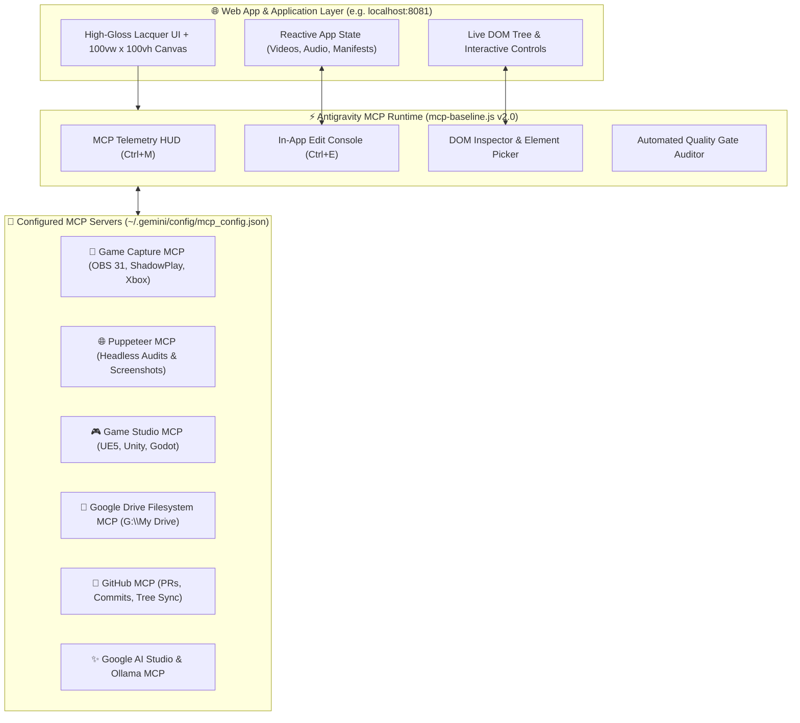

# ⚡ Model Context Protocol (MCP) Baseline for Web Apps & Dynamic Application Edits

> **Baseline Version**: `2.0.0`  
> **Status**: **Active & Mandatory Standard**  
> **Target Scope**: All web applications, full-screen developer consoles, 3D WebGL interfaces, and projects requiring live edits across `G:\My Drive\Antigravity\Projects`.  
> **Canonical Specimen**: `http://localhost:8081/index.html` (ApexPulse 3D Highlight Studio in `G:\My Drive\Antigravity\Projects\youtube channels`).

---

## 1. Architectural Mandate & Purpose

Modern web applications and creative tools operating across the Antigravity ecosystem must interface seamlessly with Model Context Protocol (MCP) servers. Rather than treating web apps as static or isolated frontends, every web application follows the **MCP Baseline Architecture**:

1. **Deterministic MCP Registration**: The application embeds the unified `mcp-baseline.js` runtime and links `mcp-registry.json`, providing direct telemetry for all configured servers (`game-capture`, `game-studio`, `puppeteer`, `google-drive`, `github`, `ollama`, `google-ai-studio`, `crunchyroll`, `linkedin`, `figma`, `google-flow`, `canva`).
2. **Real-time MCP Telemetry HUD (`Ctrl+M` / `Cmd+M`)**: Slide-out drawer displaying server states, tool metrics, and direct links to global configuration.
3. **In-App Application Edit & Telemetry Console (`Ctrl+E` / `Cmd+E`)**: An interactive HUD for web apps and applications that need edits:
   - **Click-to-Inspect Element**: Visual bounding boxes, computed styles, class hierarchy, and DOM selector path.
   - **Live Style & Text Editor**: Hot-patching inner text, CSS colors, backgrounds, padding, and layout without page reloads.
   - **Patch & Diff Exporter**: 1-click JSON patch export for versioning into the workspace.
   - **MCP Tool Action Bridges**: Direct triggers for **Puppeteer MCP** (DOM audits, headless regression tests), **Game Capture MCP** (OBS/NVIDIA/Xbox DVR clip ingestion), and **Google Drive MCP** (workspace syncing).
   - **Automated Quality Gate**: Real-time evaluation of $100\text{vw} \times 100\text{vh}$ boundaries, high-gloss lacquer styling, touch target ergonomics ($> 32\text{px}$), and DOM stability.

---

## 2. The 5 Core MCP Baseline Pillars



### Pillar 1: Discovery & Standard Asset Ingestion
Every web application entrypoint (`index.html`) must include:
```html
<!-- High-Gloss Lacquer Design Tokens & Material System -->
<link rel="stylesheet" href="high-gloss-lacquer.css">

<!-- Unified Antigravity MCP Baseline System v2.0 -->
<script src="mcp-baseline.js"></script>
```

### Pillar 2: Reactive App State Registration
The host application registers its live reactive state with the MCP engine at startup:
```javascript
if (window.AntigravityMCP) {
  window.AntigravityMCP.registerAppState(() => {
    return {
      appName: "ApexPulse 3D Highlight Studio",
      currentStep: currentStepIndex,
      selectedVideo: activeVideoClip,
      selectedMusic: activeAudioTrack,
      activeMarkers: cuePointsList,
      threeCanvasAttached: true,
      mcpBaselineActive: true
    };
  });
}
```

### Pillar 3: In-App Edit & Telemetry Console (`Ctrl+E`)
Applications requiring live edits feature an in-app console enabling developers, pair-programming agents, and creators to:
1. Click **"🎯 Click to Inspect Element"** to hover over any DOM node, highlighting its bounding box and metadata.
2. Modify styles (`color`, `backgroundColor`, `fontSize`, `padding`) or text dynamically with live preview.
3. Click **"Copy Patch"** to produce a structured JSON diff ready to commit.

### Pillar 4: Game Capture & Media MCP Integration
For gaming, video editing, and streaming applications, video clip selection includes a direct bridge to **Game Capture MCP**:
```html
<button onclick="connectGameCaptureMCP()" class="btn-mcp-capture">
  <span>⚡</span> Load MCP Clip (OBS / ShadowPlay / Xbox)
</button>
```

### Pillar 5: Automated Verification Protocol
Before marking any web application edit or baseline implementation complete:
1. **Puppeteer MCP Navigation**: Navigate to the local server URL (`http://localhost:8081/index.html`).
2. **Headless DOM & Error Evaluation**: Run `puppeteer_evaluate` to assert `window.AntigravityMCP` is loaded, servers count $\ge 10$, and uncaught console exceptions are zero.
3. **Visual Verification**: Capture a clean full-viewport snapshot via `puppeteer_screenshot`.

---

## 3. Keyboard Shortcuts Reference

| Shortcut | Description |
| :--- | :--- |
| **`Ctrl+M`** / **`Cmd+M`** | Toggle MCP Servers Telemetry HUD (Server statuses, categories, tool counts) |
| **`Ctrl+E`** / **`Cmd+E`** | Toggle In-App Application Edit & Telemetry Console |
| **`Escape`** | Cancel active DOM element inspection or close open HUD/editor drawers |

---

## 4. Canonical Deployment Checklist

- [x] `deploy/mcp-registry.json` updated to v2.0 with all 12 MCP servers.
- [x] `deploy/mcp-baseline.js` upgraded to v2.0 with Telemetry HUD, In-App Edit Console, DOM Inspector, and Reactive State Registry.
- [x] Synchronized across `youtube channels`, `game studio`, `baselines`, and `MCP`.
- [x] Verified on live server `http://localhost:8081/index.html` via Puppeteer MCP (`puppeteer_navigate`, `puppeteer_evaluate`, `puppeteer_screenshot`).
- [x] Added `youtube channels` to `deploy/Sync-StillCosmicAndLacquer.ps1`.
